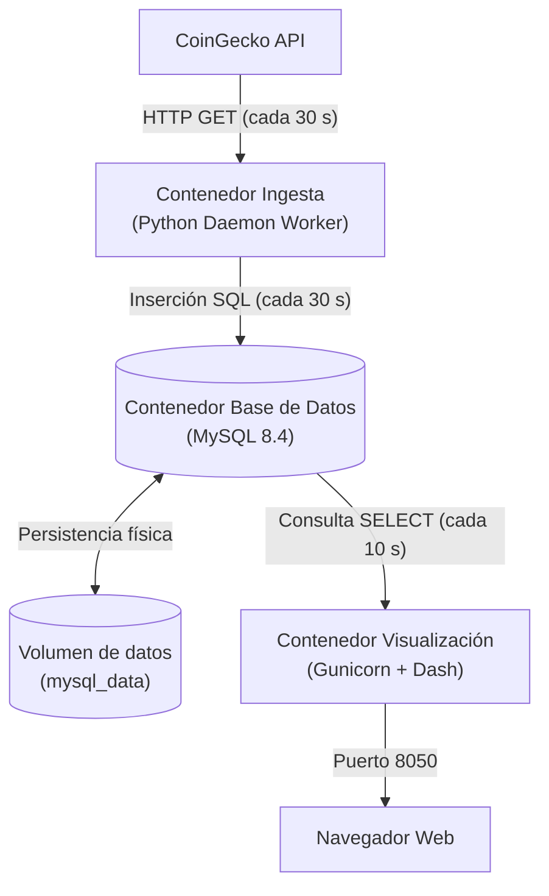

# Prototipo de Monitoreo y Visualización de Criptomonedas en Tiempo Real
**Autor:** Víctor De la Torre  
*Desarrollo de un prototipo de visualización de datos utilizando Docker, API y bases de datos.*

---

## 1. Problemática o necesidad que busca atender el proyecto

Las criptomonedas son activos digitales que permiten realizar transacciones directamente a través de una plataforma en línea, empleando mecanismos criptográficos para garantizar la seguridad de las operaciones, regular la emisión de nuevas unidades y validar transferencias de forma descentralizada.

Debido a su alta volatilidad y a que sus precios fluctúan continuamente en los mercados internacionales, resulta fundamental contar con mecanismos automatizados de monitoreo y registro histórico. En este proyecto se desarrolló un **pipeline desacoplado en microservicios contenerizados con Docker** que extrae cotizaciones de mercado en tiempo real de distintos criptoactivos, las persiste en una base de datos relacional y las presenta en una interfaz analítica interactiva para apoyar la toma de decisiones.

---

## 2. API seleccionada y datos extraídos

Se utilizó la API pública de **[CoinGecko](https://docs.coingecko.com/)** para extraer cotizaciones de tres activos principales:
* **Bitcoin (BTC)**
* **Ethereum (ETH)**
* **Solana (SOL)**

### Consulta HTTP
Se realizan peticiones `HTTP GET` periódicas al siguiente endpoint:
```text
[https://api.coingecko.com/api/v3/simple/price?ids=bitcoin,ethereum,solana&vs_currencies=usd&include_24hr_vol=true&include_24hr_change=true](https://api.coingecko.com/api/v3/simple/price?ids=bitcoin,ethereum,solana&vs_currencies=usd&include_24hr_vol=true&include_24hr_change=true)
```

### Métricas recolectadas
* **`usd`**: Precio spot o valor actual del activo en dólares estadounidenses.
* **`usd_24h_vol`**: Volumen total negociado en USD en las últimas 24 horas continuas.
* **`usd_24h_change`**: Variación porcentual del precio respecto a las últimas 24 horas.

---

## 3. Arquitectura de la solución y función de cada contenedor

El sistema se orquesta mediante **Docker Compose**, aislando las responsabilidades en tres contenedores independientes interconectados a través de una red privada virtual:




### Detalle de los microservicios

* **Contenedor Ingesta (`proyecto-crypto-ingesta-1`):**  
  Construido a partir de una imagen ligera (`python:3.12-slim`). Ejecuta en segundo plano el script `ingesta.py`. Cada 30 segundos consulta la API de CoinGecko, procesa la respuesta JSON y ejecuta sentencias `INSERT` parametrizadas en MySQL con manejo de excepciones para tolerar interrupciones de red.

* **Contenedor Base de Datos (`proyecto-crypto-mysql-1`):**  
  Ejecuta la imagen oficial `mysql:8.4`. Al iniciar por primera vez ejecuta el script de inicialización `01-init.sql` para crear la base de datos `agricultura` y la tabla `precios_crypto`. Emplea un volumen persistente de Docker (`mysql_data`) para conservar los registros históricos aunque los contenedores se detengan o reinicien.

* **Contenedor Visualización (`proyecto-crypto-dash-1`):**  
  Sirve la aplicación analítica construida con Dash/Plotly mediante el servidor WSGI **Gunicorn** sobre el puerto `8050`. Consulta la base de datos MySQL periódicamente (polling reactivo cada 10 segundos) y redibuja la curva temporal de precios según el activo seleccionado en la interfaz.

---

## 4. Diseño de la base de datos

* **Motor DBMS:** MySQL 8.4 Server  
* **Base de datos:** `agricultura`  
* **Tabla:** `precios_crypto`  

### Diccionario de datos

| Campo | Tipo de Dato | Modificadores | Descripción |
| :--- | :--- | :--- | :--- |
| **`id`** | `INT` | `PRIMARY KEY, AUTO_INCREMENT` | Identificador único y secuencial de cada registro |
| **`fecha`** | `DATETIME` | `NOT NULL` | Marca de tiempo precisa de la captura (`AAAA-MM-DD HH:MM:SS`) |
| **`criptomoneda`** | `VARCHAR(50)` | `NOT NULL` | Nombre del criptoactivo (`bitcoin`, `ethereum`, `solana`) |
| **`precio_usd`** | `DECIMAL(16,4)` | `NOT NULL` | Cotización spot del activo en dólares |
| **`volumen_24h`** | `DOUBLE` | `DEFAULT NULL` | Monto acumulado en USD operado en las últimas 24 horas |
| **`cambio_24h`** | `FLOAT` | `DEFAULT NULL` | Variación porcentual del precio frente a las 24 horas previas |

---

## 5. Demostración del prototipo y comandos de verificación

A continuación se detallan los pasos para auditar el ciclo completo de los datos (**obtención**, **almacenamiento** y **visualización**):

### 1. Verificar estado de los contenedores
```powershell
docker compose ps
```
Comprueba que los tres servicios (`dash`, `ingesta` y `mysql`) se encuentren en estado de ejecución (`Up` y `healthy`).

### 2. Verificar la obtención de datos en tiempo real
```powershell
docker compose logs ingesta --tail 10
```
Muestra las últimas transacciones realizadas por el worker hacia la API externa y su confirmación de escritura.

### 3. Verificar el almacenamiento físico en MySQL
```powershell
docker compose exec mysql mysql -u dash_user -p agricultura
```
*Contraseña:* `DashDemo2026_local`

Dentro del prompt interactivo de MySQL:
```sql
SELECT id, fecha, criptomoneda, precio_usd FROM precios_crypto ORDER BY id DESC LIMIT 3;
```
Permite auditar las últimas filas guardadas en disco. Para salir: `exit;`.

### 4. Visualización en el navegador web
Acceder desde cualquier navegador local a:  
**`http://localhost:8050`**

* Menú desplegable para alternar dinámicamente entre Bitcoin, Ethereum y Solana.
* Gráfica reactiva construida en Plotly que actualiza sus series temporales automáticamente sin recargar la página.

---

## 6. Ciclo de ejecución rápida (Script de demostración)

```powershell
# Levantar el entorno completo en segundo plano
docker compose up -d

# Validar contenedores activos
docker compose ps

# Inspeccionar logs de recolección
docker compose logs ingesta --tail 10

# Consultar directamente la base de datos
docker compose exec mysql mysql -u dash_user -p agricultura
# (Ingresar contraseña: DashDemo2026_local y correr query SELECT)

# Apagar y desmontar los servicios conservando los datos
docker compose down
```

## Cómo ejecutar el proyecto localmente

Sigue estos pasos para clonar y levantar el pipeline completo en tu máquina local.

### Prerrequisitos
Solo necesitas tener instaladas las siguientes herramientas:
* [Git](https://git-scm.com/) (o GitHub Desktop)
* [Docker Desktop](https://www.docker.com/products/docker-desktop/) (con Docker Compose activo)

> **Nota:** No es necesario tener instalados localmente Python ni MySQL, ya que todos los servicios y sus dependencias se ejecutan dentro de los contenedores aislados de Docker.

---

### Pasos de instalación y despliegue

#### 1. Clonar el repositorio
Abre una terminal y clona el proyecto en tu computadora:
```bash
git clone [https://github.com/tu-usuario/proyecto-crypto.git](https://github.com/tu-usuario/proyecto-crypto.git)
cd proyecto-crypto
```

#### 2. Configurar las variables de entorno
El proyecto incluye un archivo de plantilla `.env.example` con las credenciales de demostración local. Debes generar tu archivo `.env` a partir de esta plantilla:

* **En Windows (PowerShell):**
  ```powershell
  Copy-Item .env.example .env
  ```
* **En Linux / macOS:**
  ```bash
  cp .env.example .env
  ```

*(Opcionalmente, puedes editar el archivo `.env` resultante si deseas personalizar las contraseñas).*

#### 3. Levantar los servicios con Docker Compose
Asegúrate de que **Docker Desktop** esté abierto y ejecutándose en segundo plano. Luego, en la raíz del proyecto, corre:
```bash
docker compose up -d --build
```
Este comando:
1. Compila la imagen ligera de Python e instala las dependencias (`requirements.txt`).
2. Descarga la imagen oficial de MySQL 8.4 y ejecuta automáticamente el script de inicialización (`01-init.sql`).
3. Monta el volumen de persistencia física (`mysql_data`).
4. Enciende los tres contenedores (`mysql`, `ingesta` y `dash`) en segundo plano.

#### 4. Acceder al Dashboard
Una vez levantados los servicios, abre tu navegador web e ingresa a:  
👉 **`http://localhost:8050`**

---

### Comandos de gestión y verificación

* **Comprobar el estado de los contenedores:**
  ```bash
  docker compose ps
  ```
* **Monitorear en vivo la ingesta desde la API (CoinGecko):**
  ```bash
  docker compose logs ingesta -f
  ```
* **Consultar los registros guardados en la base de datos:**
  ```bash
  docker compose exec mysql mysql -u dash_user -p agricultura
  ```
  *(Ingresa la contraseña definida en tu `.env`, por defecto: `DashDemo2026_local`)*.  
  Luego ejecuta:
  ```sql
  SELECT id, fecha, criptomoneda, precio_usd FROM precios_crypto ORDER BY id DESC LIMIT 5;
  ```
* **Detener el sistema (conservando los datos históricos):**
  ```bash
  docker compose down
  ```
